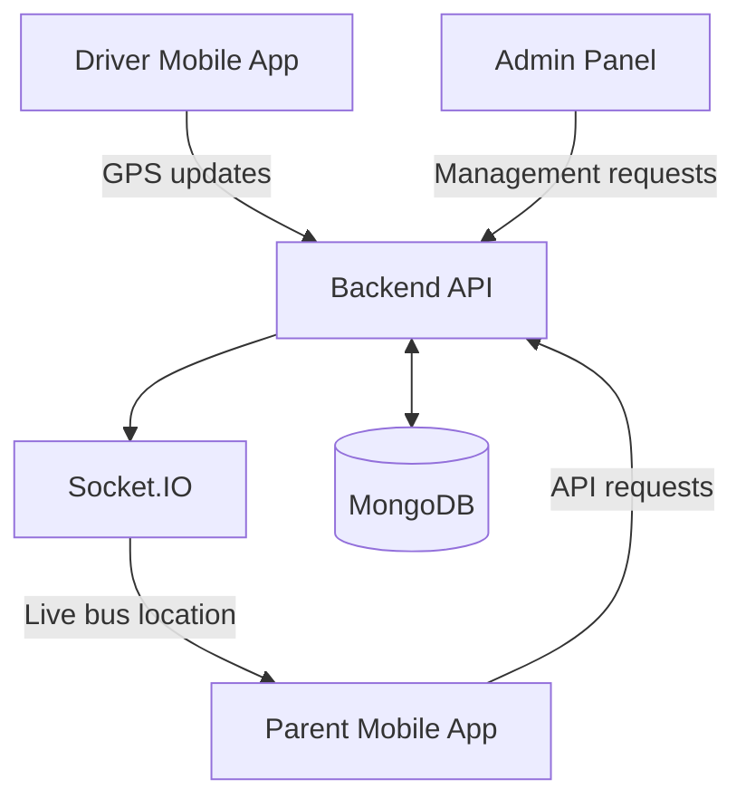

# 🚌 School Bus Tracking System

A real-time school bus tracking platform designed to help parents monitor school buses, help drivers share their live locations, and support administrators in managing the system.

The project consists of four repositories working together to provide live GPS tracking, real-time location updates, route visualization, and simulation-based testing.

## ✨ Features

- **Live GPS Tracking:** Tracks the driver's current location and updates the Parent app.
- **Real-Time Communication:** Uses Socket.IO to deliver live bus location updates.
- **Interactive Map:** Displays the bus marker and blue road route.
- **Route Visualization:** Shows the road path between the bus and the parent's pickup point.
- **ETA and Distance:** Displays estimated arrival time, distance, and speed information.
- **Driver App:** Supports trip controls and location tracking.
- **Parent App:** Displays bus location, driver information, and trip status.
- **Simulation Mode:** Allows bus movement to be tested along a simulated road route.
- **Admin Panel:** Provides a separate interface for bus system administration.

## 🏗️ Project Architecture

The project is maintained in separate repositories for easier development and maintenance.



### How it works

1. The Driver app obtains GPS coordinates or generates simulated location updates.
2. The backend receives and processes location updates.
3. Socket.IO broadcasts location events to connected clients.
4. The Parent app receives the events and moves the bus marker on the map.
5. The map displays the blue road route, while the interface presents trip information.

## 📂 Project Repositories

| Component | Repository |
|---|---|
| Backend API | [bus-tracking-backend](https://github.com/deepcoder1313/bus-tracking-backend) |
| Driver Mobile App | [driver-app](https://github.com/deepcoder1313/driver-app) |
| Parent Mobile App | [parent-app](https://github.com/deepcoder1313/parent-app) |
| Admin Panel | [bus-admin-panel](https://github.com/deepcoder1313/bus-admin-panel) |

## 🛠️ Technologies Used

### Backend
- JavaScript
- Node.js and Express
- Socket.IO
- MongoDB

### Driver and Parent Applications
- React Native
- Expo
- TypeScript
- Axios
- React Native WebView
- Leaflet for map visualization

### Mapping and Location
- GPS location services
- Road route polylines
- Directions API integration
- Simulated GPS movement for testing

### Admin Panel
- JavaScript-based web application

*Refer to each component repository for its exact dependencies and implementation details.*

## 🚀 Getting Started

### Prerequisites

Before running the project, install:

- Node.js and npm
- Git
- Expo development tools
- Android Studio or a compatible device
- MongoDB access for the backend

### 1. Clone the repositories

```bash
git clone https://github.com/deepcoder1313/bus-tracking-backend.git
git clone https://github.com/deepcoder1313/driver-app.git
git clone https://github.com/deepcoder1313/parent-app.git
git clone https://github.com/deepcoder1313/bus-admin-panel.git
```

### 2. Configure the backend

Open the backend repository and install its dependencies:

```bash
cd bus-tracking-backend
npm install
```

Configure the required environment variables according to the backend's configuration, including database access and any required API credentials.

Start the backend using the command documented in its `package.json` or README.

### 3. Configure the Driver app

```bash
cd driver-app
npm install
```

Configure the backend API URL and required permissions. Follow the scripts listed in `package.json` to launch the Expo application.

### 4. Configure the Parent app

```bash
cd parent-app
npm install
```

Configure the backend API URL and any required map or routing settings, then launch the application using its documented Expo command.

### 5. Run the Admin Panel

```bash
cd bus-admin-panel
npm install
```

Configure the backend URL and start the application using the scripts specified in its `package.json`.

> **Important:** Each application must point to the correct deployed backend or local server. Keep API credentials, database credentials, authentication secrets, and other private environment variables out of GitHub.

## 🧪 Testing

The project supports testing of both live tracking and simulated bus movement.

Recommended checks:

- Start a trip and confirm that GPS updates reach the backend.
- Verify that the Parent app receives live location events.
- Confirm that the bus marker follows the location updates.
- Check that the blue route is aligned with the road and bus position.
- Test simulation mode without relying on a moving vehicle.
- End the trip and verify that the Parent app reflects the correct status.
- Test recovery after a temporary network interruption.

## 📸 Screenshots and Demo

Screenshots and a demonstration video can be added here to show the running system.

Suggested screenshots:

1. Driver app during an active trip.
2. Parent app showing the live bus marker and blue route.
3. Bus information card displaying speed, ETA, and distance.
4. Simulation mode following a road route.
5. Admin Panel interface.

## 🔐 Security and Privacy

- Do not commit API keys, passwords, tokens, or database credentials.
- Use authenticated requests for protected backend endpoints.
- Keep production secrets in environment variables.
- Ensure that access to live bus locations is restricted to authorized users.

## 🔮 Future Improvements

- Push notifications for approaching buses and trip status changes.
- Route deviation detection and alerts.
- Historical trip playback.
- Improved handling of network interruptions.
- Automated testing and deployment.
- More detailed analytics for administrators.

## 👨‍💻 Author

**deepcoder1313**

GitHub: [@deepcoder1313](https://github.com/deepcoder1313)

## 📄 License

Check the license files in the individual repositories before specifying a license for the complete project.

---

*This project demonstrates the integration of mobile applications, backend APIs, real-time communication, GPS tracking, and interactive maps into a unified school transportation platform.*
