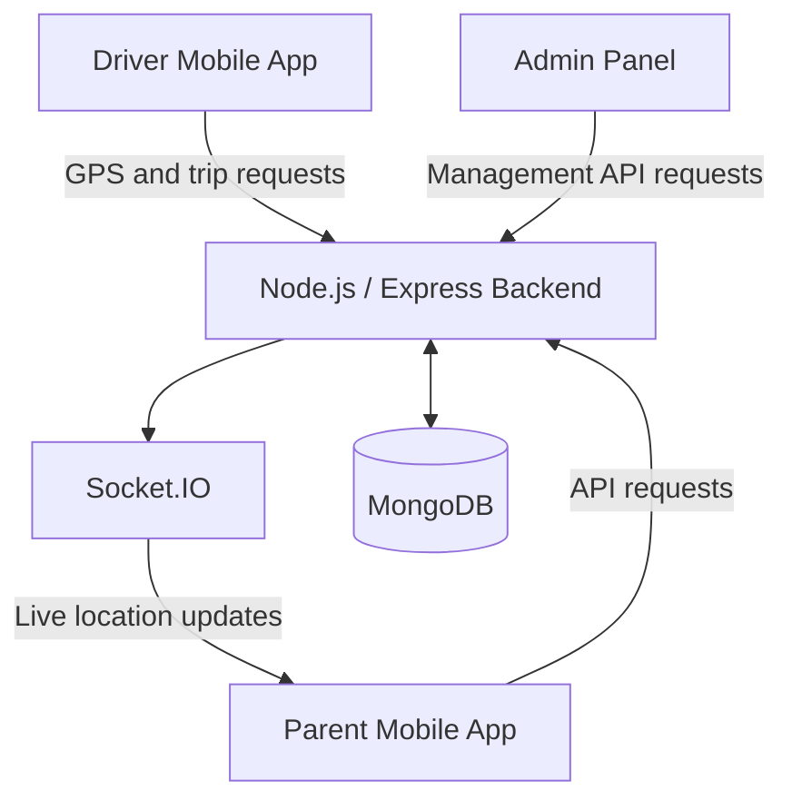

# 🚌 School Bus Tracking System

A real-time school bus tracking platform designed to help parents monitor school buses, help drivers share their live locations, and support administrators in managing school transportation.

The project consists of four separately maintained repositories working together to provide live GPS tracking, route visualization, trip management, notifications, and administrative functionality.

## ✨ Features

- **Live GPS Tracking:** Tracks the driver's current location and updates the Parent app.
- **Real-Time Communication:** Uses Socket.IO to deliver bus location updates.
- **Interactive Map:** Displays the bus marker and blue road route.
- **Route Visualization:** Shows the road path between the bus and its destination or pickup point.
- **ETA and Distance:** Supports estimated arrival time, distance, and speed information.
- **Driver App:** Supports trip controls and GPS location tracking.
- **Parent App:** Displays bus location, driver information, and trip status.
- **Push Notifications:** Supports bus-arrival and trip-related notifications.
- **Admin Panel:** Provides an interface for managing buses, drivers, students, routes, and trips.
- **Simulation Mode:** Allows bus movement to be tested using simulated GPS updates.

## 🏗️ System Architecture



### Data Flow

1. The Driver app sends GPS coordinates and trip updates to the backend.
2. The backend processes requests and interacts with MongoDB.
3. Socket.IO distributes live location updates to connected clients.
4. The Parent app receives location updates and refreshes the bus marker and route visualization.
5. The Admin Panel uses backend APIs to manage system data.

## 📂 Project Repositories

| Component | Repository |
|---|---|
| Backend API | [bus-tracking-backend](https://github.com/deepcoder1313/bus-tracking-backend) |
| Driver Mobile App | [driver-app](https://github.com/deepcoder1313/driver-app) |
| Parent Mobile App | [parent-app](https://github.com/deepcoder1313/parent-app) |
| Admin Panel | [bus-admin-panel](https://github.com/deepcoder1313/bus-admin-panel) |

Each component is maintained in its own GitHub repository with its own source code and Git history.

## 🛠️ Technologies Used

### Backend
- JavaScript
- Node.js and Express.js
- Socket.IO
- MongoDB
- JWT authentication

### Driver and Parent Applications
- React Native
- Expo
- TypeScript and JavaScript, depending on the component
- Axios
- React Native WebView

### Mapping and Location
- GPS location services
- Road route polylines
- Directions API integration
- Simulated GPS movement for testing

### Admin Panel
- JavaScript-based web application

Refer to each component repository for its exact dependencies and implementation details.

## 🚀 Getting Started

### Prerequisites

Install the tools required by the individual applications:

- Node.js and npm
- Git
- Expo development tools
- Android Studio or a compatible mobile device
- MongoDB access for the backend

### 1. Clone the repositories

Clone each component separately:

```bash
git clone https://github.com/deepcoder1313/bus-tracking-backend.git
git clone https://github.com/deepcoder1313/driver-app.git
git clone https://github.com/deepcoder1313/parent-app.git
git clone https://github.com/deepcoder1313/bus-admin-panel.git
```

### 2. Configure the backend

Open the backend repository and install its dependencies:

```bash
cd bus-tracking-backend
npm install
```

Configure the required environment variables using the backend's `.env.example` file, where available. Set up the database connection and any required API credentials.

Start the backend using the command documented in its `package.json` or README.

### 3. Configure the Driver app

```bash
cd driver-app
npm install
```

Configure the backend API URL and required device permissions. Follow the scripts in `package.json` to launch the Expo application.

### 4. Configure the Parent app

```bash
cd parent-app
npm install
```

Configure the backend API URL and any required mapping or routing settings, then launch the application using its documented Expo command.

### 5. Run the Admin Panel

```bash
cd bus-admin-panel
npm install
```

Configure the backend URL and start the application using the scripts specified in its `package.json`.

**Important:** Each application must point to the correct backend server. Keep API keys, database credentials, authentication secrets, and other private environment variables out of GitHub.

## 🧪 Testing

Recommended checks include:

- Start a trip and confirm that GPS updates reach the backend.
- Verify that the Parent app receives live location events.
- Confirm that the bus marker follows location updates.
- Check that the blue route follows the road and reflects the bus position.
- Test simulated GPS movement without relying on a moving vehicle.
- End a trip and verify that the trip status updates correctly.
- Test recovery after a temporary network interruption.
- Verify that push notifications work under the expected conditions.

## 📸 Screenshots and Demo

Add screenshots or a demonstration video here to show the running system.

Suggested screenshots:

1. Driver app during an active trip.
2. Parent app showing the live bus marker and blue route.
3. Bus information card displaying speed, ETA, and distance.
4. Simulated bus movement along a road route.
5. Admin Panel interface.

## 🔐 Security and Privacy

- Do not commit API keys, passwords, tokens, or database credentials.
- Require authentication for protected backend operations.
- Restrict access to live bus locations to authorized users.
- Validate access to student and parent information.
- Keep production secrets in environment variables.

## 🔮 Future Improvements

- Multi-school onboarding with school-specific data isolation.
- School-level administrator accounts and role-based access control.
- Stronger authorization for APIs, live-location events, and notifications.
- Route-deviation detection and alerts.
- Historical trip playback.
- Improved handling of network interruptions.
- Automated testing and deployment.
- More detailed analytics for administrators.

Multi-school support and school-specific data isolation are planned improvements, not yet claimed as completed features.

## 👨‍💻 Author

**deepcoder1313**

GitHub: [@deepcoder1313](https://github.com/deepcoder1313)

## 📄 License

Check the license files in the individual repositories before specifying a license for the complete project.

---

*This project demonstrates the integration of mobile applications, backend APIs, real-time communication, GPS tracking, and interactive maps into a school transportation platform.*